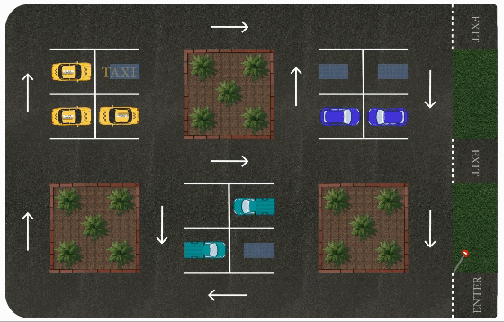
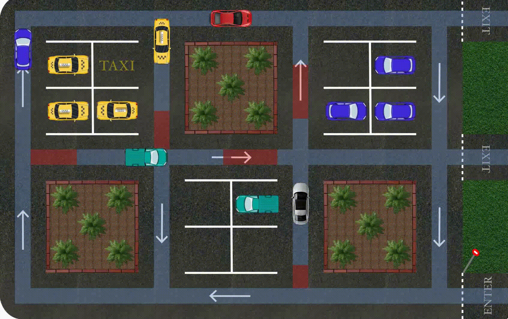

# zonopy - Hybrid Zonotope-Based Reachability Analysis

This repository contains the source-code developed and used to generate all the results in the research paper "Formal Verification of Linear Temporal Logic Specifications Using Hybrid Zonotope-Based Reachability Analysis", as well as the MSc thesis project "Hybrid Zonotope-Based Reachability Analysis For Linear Temporal Logic Specifications".

If you use the corresponding parts of our code or data in your work, please cite our paper:

    @inproceedings{
        hadjiloizou2022Formal,
        title = {Formal Verification of Linear Temporal Logic Specifications Using Hybrid Zonotope-Based Reachability Analysis},
        author = {Hadjiloizou, Loizos and Jiang, Frank J. and Alanwar, Amr and Johansson, Karl H.},
        booktitle = {IEEE European Control Conference},
        year = {2024}
    }
> **Abstract**: In this paper, we introduce a hybrid zonotope-based approach for formally verifying the behavior of autonomous systems operating under Linear Temporal Logic (LTL) specifications. In particular, we formally verify the LTL formula by constructing temporal logic trees (TLT)s via backward reachability analysis (BRA). In previous works, TLTs are predominantly constructed with either highly general and computationally intensive level set-based BRA or simplistic and computationally efficient polytope-based BRA. In this work, we instead propose the construction of TLTs using hybrid zonotope-based BRA. By using hybrid zonotopes, we show that we are able to formally verify LTL specifications  in a computationally efficient manner while still being able to represent complex geometries that are often present when deploying autonomous systems, such as non-convex, disjoint sets. Moreover, we evaluate our approach on a parking example, providing preliminary indications of how hybrid zonotopes facilitate computationally efficient formal verification of LTL specifications in environments that naturally lead to non-convex, disjoint geometries.

## Features

This package has been implemented with the aim of providing a set of tools for performing formal verification of autonomous systems operating under Linear Temporal Logic (LTL) specifications using the Temporal Logic Tree (TLT) structure introduced in [1]. This entails the use of various set operations including computing reachable sets. Therefore, this code contains the python implementation of various zonotope, constrained zonotope, and hybrid zonotope operations. A list of the main operations currently supported by this package for each set representation method is provided in the table below.

|                       | Zonotope | Constrained Zonotope | Hybrid Zonotope |
|-----------------------|:--------:|:--------------------:|:---------------:|
| Linear Transformation |  &#x2713; | &#x2713; | &#x2713; |
| Minkowski Sum         |  &#x2713; | &#x2713; | &#x2713; |
| Minkowski Difference  |  &#x2717;   | &#x2717;   | &#x2713; |
| Union                 |  &#x2717;   | &#x2717;   | &#x2713; |
| Intersection          |  &#x2717;   | &#x2713;   | &#x2713; |
| Complement            |  &#x2717;   | &#x2713; | &#x2713; |
| Forward Reachability Analysis  |  &#x2717;   | &#x2717;   | &#x2713; |
| Backward Reachability Analysis |  &#x2717;   | &#x2717;   | &#x2713; |

## Setup

### Dependenices

This code has been tested on Python 3.8.13. The following non-standard Python libraries are required:

* gurobipy (tested with version 10.0.1)
* scipy    (tested with version 1.10.1)
* pycddlib (tested with version 2.1.6)

## Demo

### Static Environment

To run the demo for the static environment, use the script

* main-static_env.py

A demonstration of the results of main-static_env is provided here

### Dynamic Environment

To run the demo for the dynamic environment, use the script

* main-dynamic_env.py

A demonstration of the results of main-dynamic_env is provided here

## References

[1] Temporal Logic Trees for Model Checking and Control Synthesis of Uncertain Discrete-Time Systems, Yulong Gao, et al., IEEE Transactions on Automatic Control, 2021.
